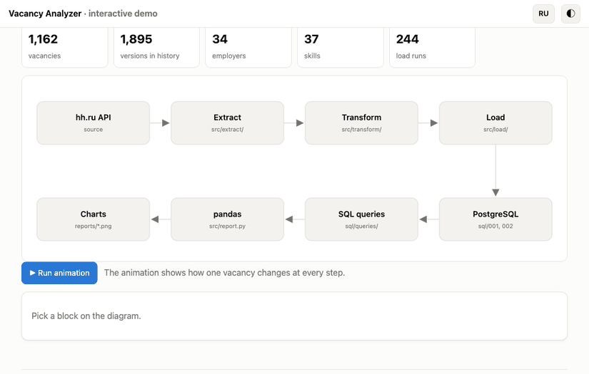
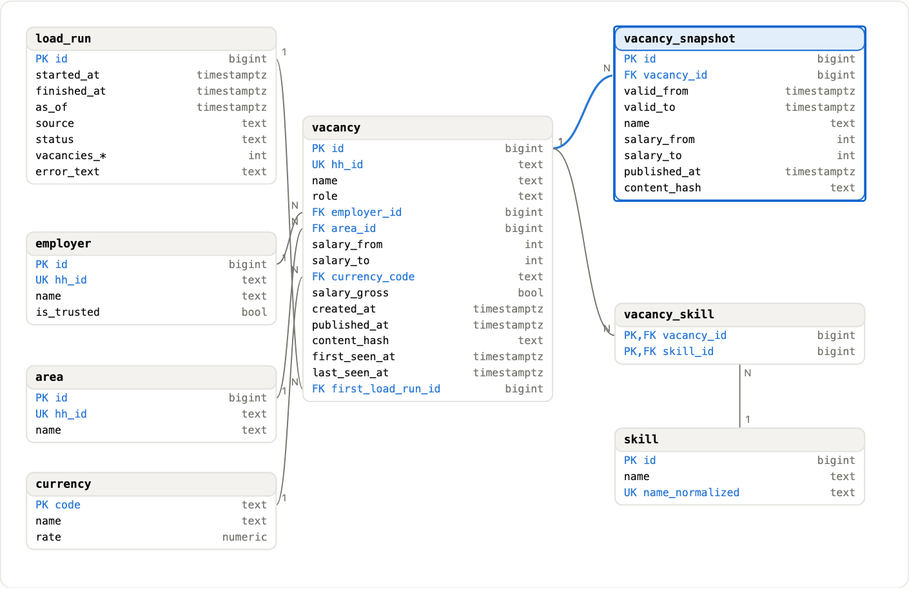
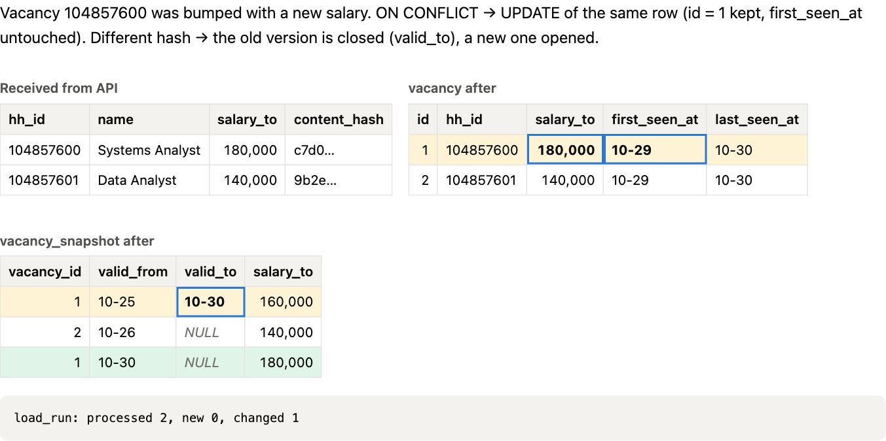
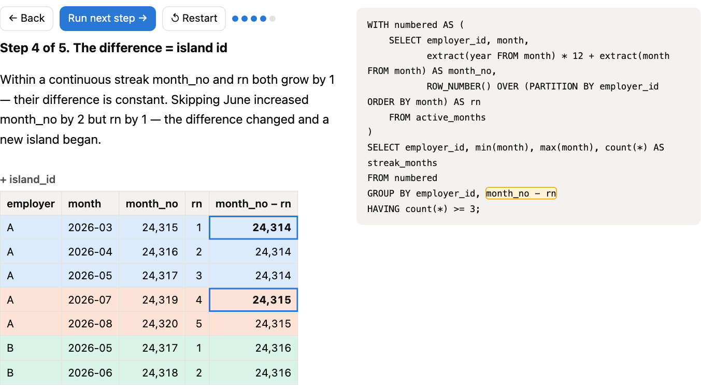
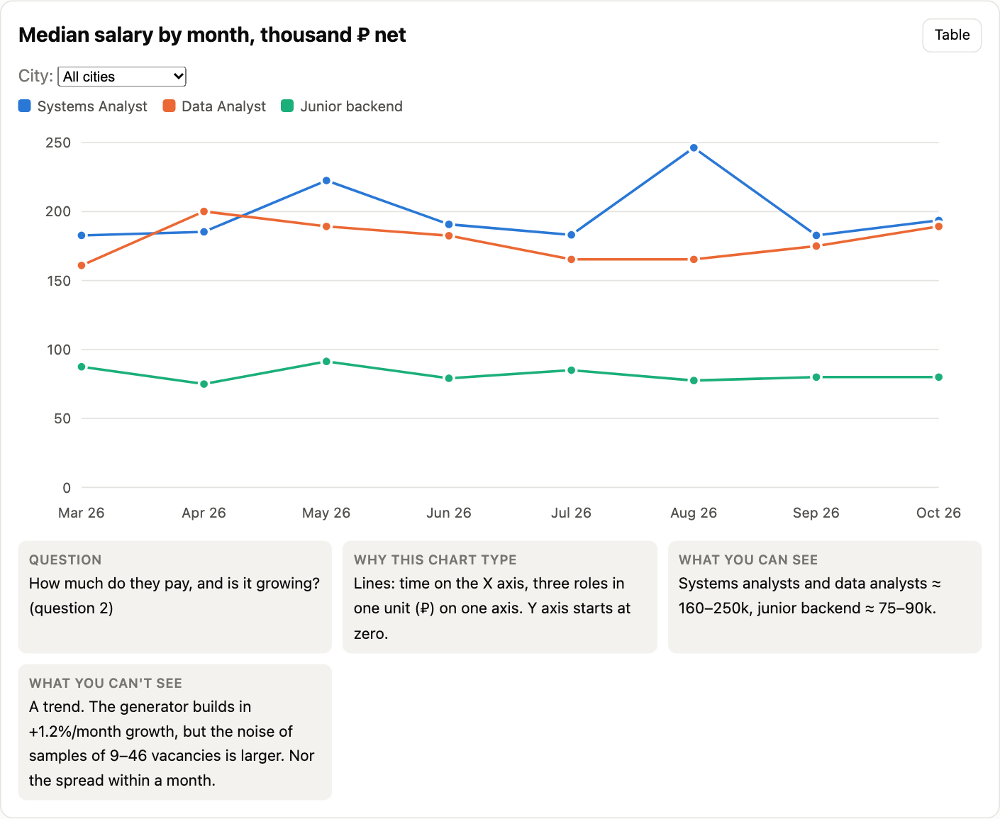
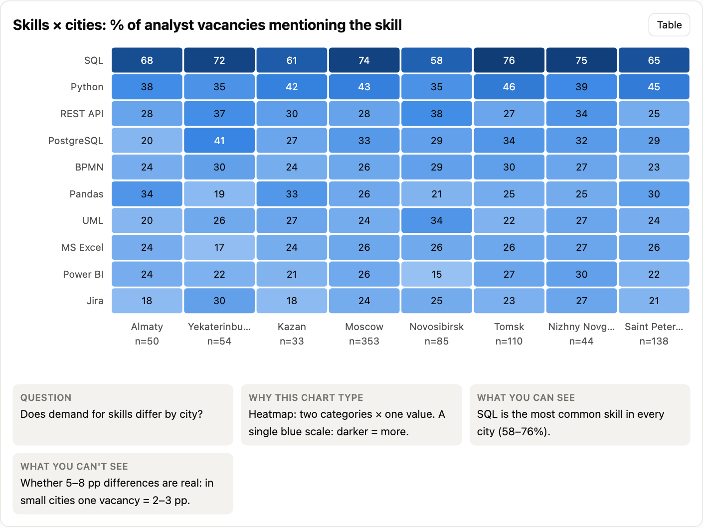
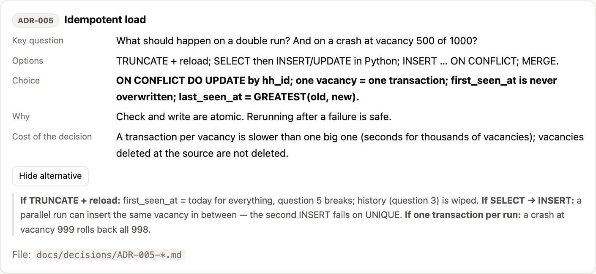
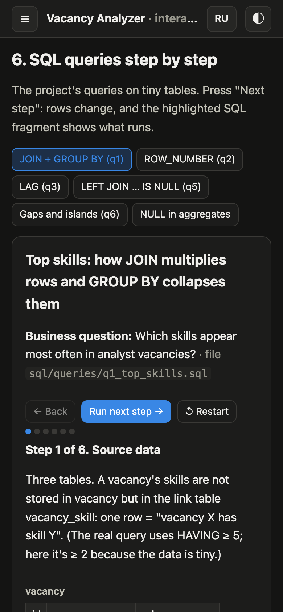

# Vacancy Analyzer

[Русская версия](README.md)

<p align="center">
  <a href="https://squidi9qt.github.io/vacancy-analyzer/?lang=en"></a>
</p>

<p align="center">
  <a href="https://squidi9qt.github.io/vacancy-analyzer/?lang=en"></a><br>
  <sub>Click the image to open the live demo. Runs in the browser, in English and Russian.</sub>
</p>

The service collects job postings for systems analysts, data analysts and junior backend developers from the hh.ru API, stores them in PostgreSQL with change history, and answers six business questions: which skills are in demand, how much is paid, who is hiring, where salaries are hidden, what appeared this week, and which companies hire steadily.

## Highlights

- **Requirements:** goals and metrics, user stories with acceptance criteria, use cases, open questions with decisions.
- **Data model:** 8 tables, change history (SCD2), integrity constraints, 6 architecture decision records (ADR).
- **Data loading (ETL):** reruns without duplicates, retries on API errors with exponential backoff, a load run log.
- **SQL analytics:** CTEs, window functions, medians, GROUPING SETS, gaps-and-islands. The two heaviest queries were made 12× and 28× faster based on EXPLAIN ANALYZE.
- **Results:** charts and an interactive bilingual demo.
- **Quality:** 50 automated tests.

## Demo

| | |
|---|---|
| **Data model:** click a table to see its keys and constraints<br>[](https://squidi9qt.github.io/vacancy-analyzer/?lang=en#model) | **Data loading:** what happens on a repeated run<br>[](https://squidi9qt.github.io/vacancy-analyzer/?lang=en#etl) |
| **SQL step by step:** finding continuous streaks of months<br>[](https://squidi9qt.github.io/vacancy-analyzer/?lang=en#sql) | **Results:** median salary with hover tooltips<br>[](https://squidi9qt.github.io/vacancy-analyzer/?lang=en#charts) |
| **Skills × cities**<br>[](https://squidi9qt.github.io/vacancy-analyzer/?lang=en#charts) | **Design decisions** with alternatives<br>[](https://squidi9qt.github.io/vacancy-analyzer/?lang=en#decisions) |

<p align="center"><br><sub>Mobile layout, dark theme</sub></p>

## Business questions and SQL

| # | Question | Query | SQL technique |
|---|----------|-------|---------------|
| 1 | Which skills appear most often in analyst vacancies? | [`q1_top_skills.sql`](sql/queries/q1_top_skills.sql) | CTE, FILTER, HAVING, RANK |
| 2 | How did the median salary change by month? | [`q2_salary_median_by_month.sql`](sql/queries/q2_salary_median_by_month.sql) | ROW_NUMBER, percentile_cont, GROUPING SETS |
| 3 | Who posts the most, and how often do they update? | [`q3_employers_activity.sql`](sql/queries/q3_employers_activity.sql) | LAG, IS DISTINCT FROM |
| 4 | Share of vacancies without a salary, by region | [`q4_no_salary_by_region.sql`](sql/queries/q4_no_salary_by_region.sql) | ROLLUP, confidence intervals |
| 5 | New vacancies in the last 7 days, deduplicated | [`q5_new_last_7_days.sql`](sql/queries/q5_new_last_7_days.sql) | anti-join (LEFT JOIN … IS NULL) |
| 6 | Who has been hiring 3+ months in a row | [`q6_stable_employers.sql`](sql/queries/q6_stable_employers.sql) | gaps and islands |

## Stack

Python 3.12+, PostgreSQL 16, psycopg 3 (no ORM), pandas, matplotlib, pytest, Docker Compose, GitHub Pages.

## Data

Without an application token the hh.ru API returns `403`, so the project runs on synthetic data in the API response format: 1,163 vacancies from March to October 2026 with change history. The generator is deterministic, so the numbers are reproducible. **Findings describe synthetic data, not the real job market; employers are fictional.** A client for the real API is implemented and enabled via `.env` (`DATA_SOURCE=api`, `HH_ACCESS_TOKEN`).

## Run it

Requires Python 3.12+ and PostgreSQL 16 (local or via `docker compose up -d`).

```bash
python3 -m venv .venv && source .venv/bin/activate
pip install -r requirements.txt
cp .env.example .env
```

```bash
python -m src.main init-db
python -m src.main backfill --from 2026-03-01 --to 2026-10-30
python -m src.main report
pytest -q
```

Charts and CSV files appear in `reports/`; the demo opens from `explainer/index.html`.

## Structure

| Path | Contents |
|------|----------|
| [`docs/requirements/`](docs/requirements/) | Goals, stakeholders, user stories, use cases, open questions (in Russian) |
| [`docs/data_model.md`](docs/data_model.md) | ER diagram and table descriptions |
| [`docs/decisions/`](docs/decisions/) | ADR-001…006 |
| [`docs/query_plans/`](docs/query_plans/) | Query plans before and after optimization |
| [`sql/`](sql/) | Schema, indexes, queries |
| [`src/`](src/) | ETL, report, API |
| [`tests/`](tests/) | Automated tests |
| [`explainer/`](explainer/) | Interactive demo |
| [`reports/`](reports/) | matplotlib charts and CSV |
