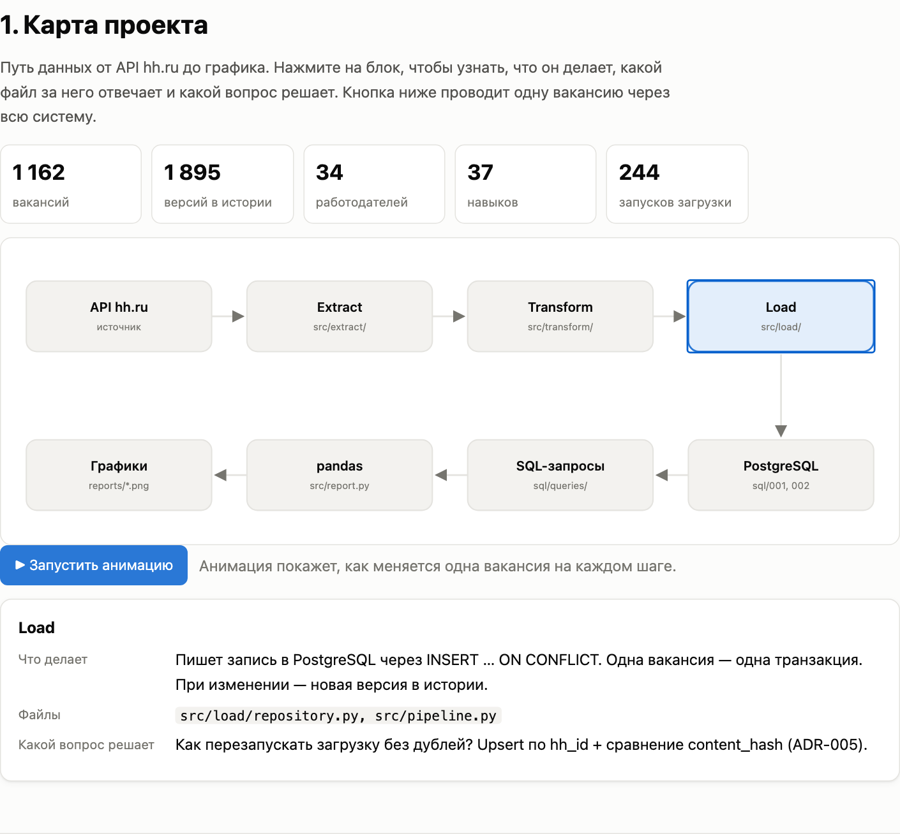
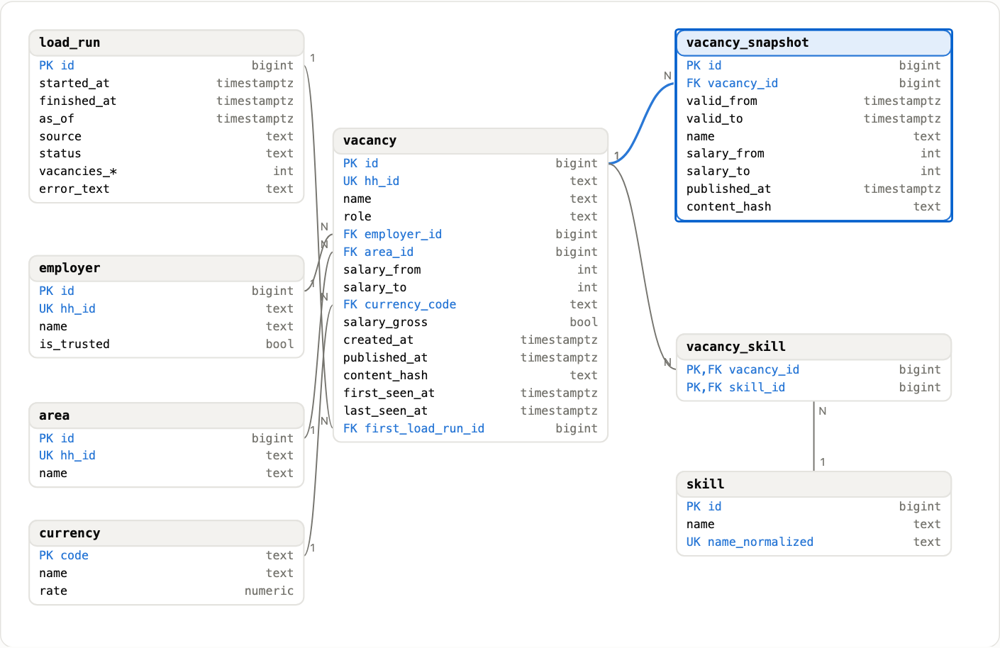
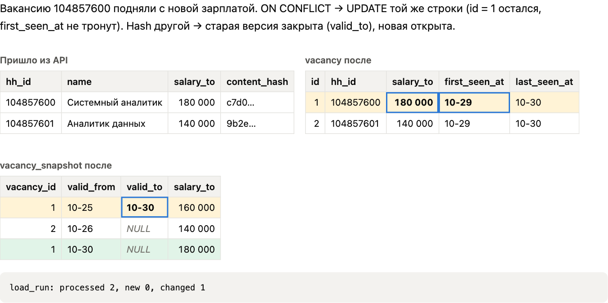
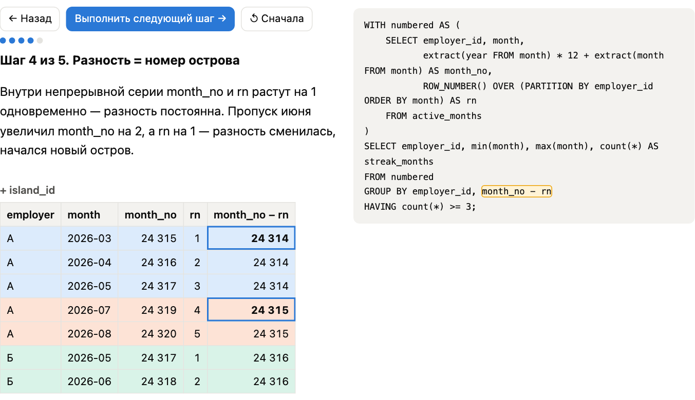
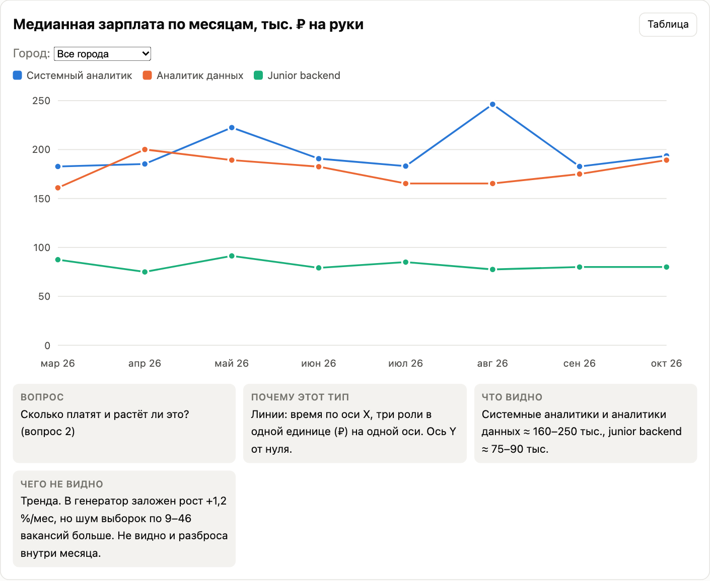
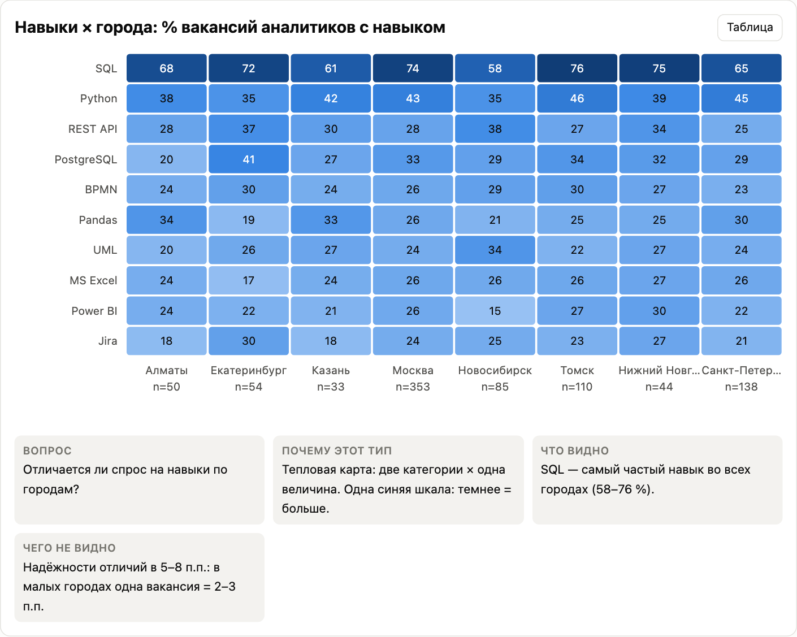
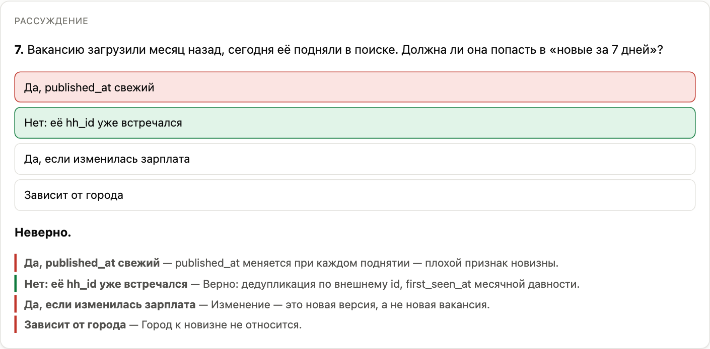
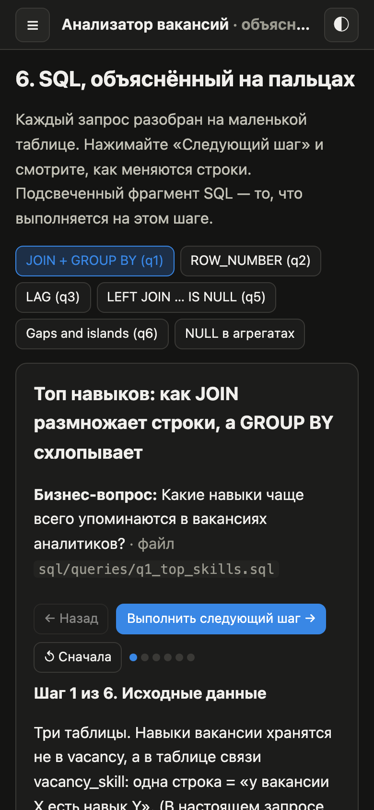

# Анализатор вакансий

[English version](README.en.md)

Учебный проект системного аналитика. Сервис собирает вакансии системных аналитиков, аналитиков данных и junior-backend разработчиков из официального API hh.ru, хранит их в PostgreSQL с историей изменений и отвечает на 6 бизнес-вопросов SQL-запросами и графиками.

**Главный артефакт** — интерактивное объяснение: [онлайн](https://squidi9qt.github.io/vacancy-analyzer/) или локально `explainer/index.html` (открывается двойным кликом, сервер не нужен).

## Демо

**👉 [Открыть интерактивное объяснение проекта](https://squidi9qt.github.io/vacancy-analyzer/)** — работает прямо в браузере, ничего ставить не нужно.

Можно потыкать: анимацию пути вакансии через систему, кликабельную ER-диаграмму, демо повторной загрузки (ON CONFLICT), пошаговые SQL-уроки на маленьких таблицах, графики с подсказками и тест с разбором ответов.

[](https://squidi9qt.github.io/vacancy-analyzer/#map)

| | |
|---|---|
| **Модель данных:** клик по таблице объясняет ключи и ограничения<br>[](https://squidi9qt.github.io/vacancy-analyzer/#model) | **ETL:** что происходит при повторном запуске загрузки<br>[](https://squidi9qt.github.io/vacancy-analyzer/#etl) |
| **SQL по шагам:** gaps and islands на маленькой таблице<br>[](https://squidi9qt.github.io/vacancy-analyzer/#sql) | **Графики:** медиана зарплат с подсказкой при наведении<br>[](https://squidi9qt.github.io/vacancy-analyzer/#charts) |
| **Навыки × города**<br>[](https://squidi9qt.github.io/vacancy-analyzer/#charts) | **Проверь себя:** разбор каждого варианта ответа<br>[](https://squidi9qt.github.io/vacancy-analyzer/#selfcheck) |

<p align="center"><br><sub>Мобильная версия, тёмная тема</sub></p>

Графики отчёта (matplotlib) — в [`reports/`](reports/), например [топ навыков](reports/01_top_skills.png) и [доля вакансий без зарплаты](reports/03_no_salary_by_city.png).

## Данные: важно прочитать

API hh.ru на анонимный запрос ответил `403 {"errors":[{"type":"forbidden"}]}` (проверено 2026-10-31). Поэтому проект по умолчанию работает на **фикстурах**: `tests/fixtures/hh_world.json` — синтетический «мир» из 1163 вакансий за март–октябрь 2026 в формате ответов API hh.ru, с историей изменений. Генератор `scripts/generate_fixtures.py` детерминирован (seed=42): у всех получаются одни и те же цифры.

**Все выводы в отчёте — выводы о синтетических данных, а не о реальном рынке.** Работодатели вымышленные.

Реальный клиент API (`src/extract/http_client.py`) написан и покрыт тестами на поддельной HTTP-сессии. Чтобы включить его, получите токен приложения на dev.hh.ru и укажите в `.env`: `DATA_SOURCE=api`, `HH_ACCESS_TOKEN=…`, `HH_USER_AGENT=ВашеПриложение/1.0 (ваш@email)`.

## Как запустить за 5 минут

Нужны Python 3.12+ и PostgreSQL 16. Разработка шла на Python 3.14 и PostgreSQL 16 из Homebrew.

```bash
# 1. Окружение и зависимости
python3 -m venv .venv
source .venv/bin/activate
pip install -r requirements.txt
cp .env.example .env
```

**2. База.** Вариант А — Docker:

```bash
docker compose up -d
```

Вариант Б — локальный PostgreSQL. Создайте две базы и поправьте `DATABASE_URL` и `TEST_DATABASE_URL` в `.env` (например, `postgresql:///vacancies`):

```bash
createdb vacancies && createdb vacancies_test
```

```bash
# 3. Схема, данные за 8 месяцев (244 «ежедневных» запуска, ~3 с), отчёт
python -m src.main init-db
python -m src.main backfill --from 2026-03-01 --to 2026-10-30
python -m src.main report

# 4. Проверка
pytest -q
```

После этого: графики и CSV — в `reports/`, сайт — `explainer/index.html`.

Другие команды:

```bash
python -m src.main load --days 7      # загрузка за 7 дней (на фикстурах «сегодня» = FIXTURE_NOW)
python -m src.main init-db --reset    # удалить ВСЕ данные и создать схему заново
psql -d vacancies -f sql/queries/q6_stable_employers.sql   # любой запрос — прямо в psql
```

## Структура

| Путь | Что там |
|------|---------|
| `docs/requirements/` | Цели и метрики, стейкхолдеры, 8 user stories, 3 use case, глоссарий, 10 открытых вопросов с решениями |
| `docs/data_model.md` | ER-диаграмма (Mermaid), назначение таблиц, ограничения, почему нормализация |
| `docs/decisions/` | ADR-001…006: ключи, валюта, история (SCD2), навыки, идемпотентная загрузка, отказ от ORM |
| `docs/query_plans/` | EXPLAIN ANALYZE до и после оптимизации на базе в 300 тыс. вакансий |
| `docs/sqlite_vs_postgres.md` | Чем пришлось бы жертвовать на SQLite |
| `docs/journal.md`, `docs/summary.md` | Журнал этапов и итоговая сводка |
| `sql/001_schema.sql`, `sql/002_indexes.sql` | Схема и индексы, добавленные по результатам замеров |
| `sql/queries/` | По файлу на бизнес-вопрос (q1–q6, q1b для тепловой карты) |
| `src/extract/` | Клиент API: пагинация, повторы с экспоненциальной задержкой, таймауты; клиент-симулятор на фикстурах |
| `src/transform/` | JSON → плоские записи: зарплата, навыки, роль, хэш содержимого |
| `src/load/`, `src/pipeline.py` | Upsert в PostgreSQL, история версий, журнал запусков |
| `src/report.py` | Графики matplotlib, CSV, `explainer/data.js` |
| `src/api.py` | Опционально: `GET /api/summary` (нужен `pip install uvicorn`, запуск `python -m src.main serve`) |
| `tests/` | 50 тестов: transform, extract без сети, загрузка на тестовой БД, API |
| `explainer/` | Интерактивное объяснение проекта |
| `scripts/` | Генератор фикстур, «большая» база для замеров, сохранение планов, проверка сайта и скриншоты (Playwright) |
| `scripts/publish_demo.sh` | Публикация `explainer/` на GitHub Pages (ветка `gh-pages`) |

## Шесть бизнес-вопросов

| # | Вопрос | Запрос | Приём SQL |
|---|--------|--------|-----------|
| 1 | Какие навыки чаще всего в вакансиях аналитиков? | `q1_top_skills.sql` | CTE, JOIN через таблицу связи, FILTER, HAVING, RANK |
| 2 | Как менялась медианная зарплата по месяцам (роль, город)? | `q2_salary_median_by_month.sql` | ROW_NUMBER (первая версия), percentile_cont, GROUPING SETS |
| 3 | Кто публикует больше всего и как часто обновляет? | `q3_employers_activity.sql` | LAG с именованным окном, IS DISTINCT FROM |
| 4 | Доля вакансий без зарплаты по регионам | `q4_no_salary_by_region.sql` | avg по условию, ROLLUP, HAVING (+ интервалы Уилсона в отчёте) |
| 5 | Новые за 7 дней, без дублей по внешнему id | `q5_new_last_7_days.sql` | LEFT JOIN … IS NULL (anti-join), коррелированный подзапрос |
| 6 | Кто нанимает 3+ месяца подряд | `q6_stable_employers.sql` | gaps-and-islands |

## Проверка сайта

```bash
pip install playwright && python -m playwright install chromium
python scripts/check_explainer.py
```

Скрипт открывает сайт как файл, нажимает все интерактивные элементы, проверяет консоль и вёрстку на ширине 375 px.
