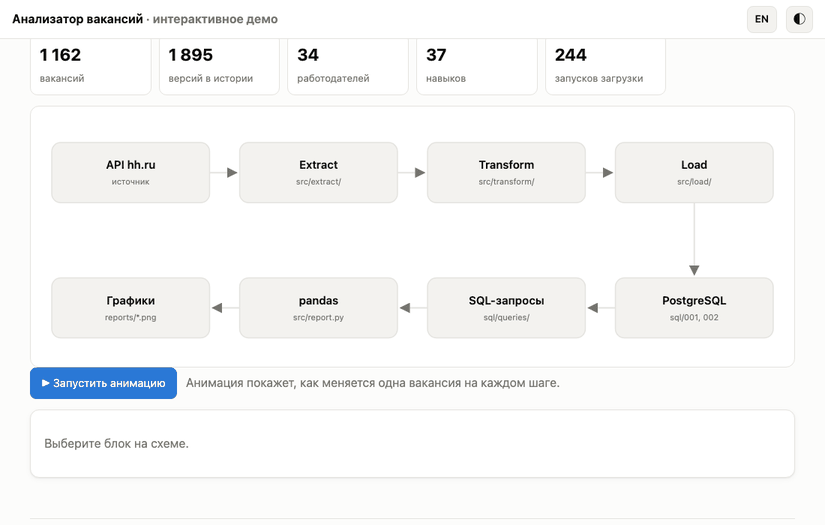
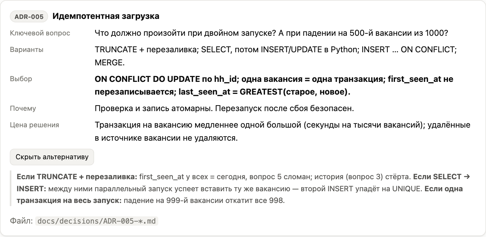

# Анализатор вакансий

[English version](README.en.md)

<p align="center">
  <a href="https://squidi9qt.github.io/vacancy-analyzer/?lang=ru"></a>
</p>

<p align="center">
  <a href="https://squidi9qt.github.io/vacancy-analyzer/?lang=ru"></a><br>
  <sub>Нажмите на картинку — откроется живое демо. Работает в браузере, на русском и английском.</sub>
</p>

Сервис собирает вакансии системных аналитиков, аналитиков данных и junior-backend разработчиков из API hh.ru, хранит их в PostgreSQL с историей изменений и отвечает на шесть бизнес-вопросов: какие навыки нужны, сколько платят, кто нанимает, где скрывают зарплату, что появилось за неделю и какие компании нанимают постоянно.

## Что внутри

- **Требования:** цели и метрики, user stories с критериями приёмки, use cases, открытые вопросы с принятыми решениями.
- **Модель данных:** 8 таблиц, история изменений (SCD2), ограничения целостности, 6 архитектурных решений (ADR).
- **Загрузка (ETL):** повторный запуск без дублей, повторы при ошибках API с экспоненциальной задержкой, журнал запусков.
- **SQL-аналитика:** CTE, оконные функции, медиана, GROUPING SETS, gaps-and-islands. Два самых тяжёлых запроса ускорены в 12 и 28 раз по результатам EXPLAIN ANALYZE.
- **Результаты:** графики и интерактивное демо на двух языках.
- **Качество:** 50 автотестов.

## Демо

| | |
|---|---|
| **Модель данных:** клик по таблице показывает ключи и ограничения<br>[](https://squidi9qt.github.io/vacancy-analyzer/?lang=ru#model) | **Загрузка:** что происходит при повторном запуске<br>[](https://squidi9qt.github.io/vacancy-analyzer/?lang=ru#etl) |
| **SQL по шагам:** поиск непрерывных серий месяцев<br>[](https://squidi9qt.github.io/vacancy-analyzer/?lang=ru#sql) | **Результаты:** медиана зарплат с подсказкой при наведении<br>[](https://squidi9qt.github.io/vacancy-analyzer/?lang=ru#charts) |
| **Навыки × города**<br>[](https://squidi9qt.github.io/vacancy-analyzer/?lang=ru#charts) | **Архитектурные решения** с альтернативами<br>[](https://squidi9qt.github.io/vacancy-analyzer/?lang=ru#decisions) |

<p align="center"><br><sub>Мобильная версия, тёмная тема</sub></p>

## Бизнес-вопросы и SQL

| # | Вопрос | Запрос | Приём SQL |
|---|--------|--------|-----------|
| 1 | Какие навыки чаще всего в вакансиях аналитиков? | [`q1_top_skills.sql`](sql/queries/q1_top_skills.sql) | CTE, FILTER, HAVING, RANK |
| 2 | Как менялась медианная зарплата по месяцам? | [`q2_salary_median_by_month.sql`](sql/queries/q2_salary_median_by_month.sql) | ROW_NUMBER, percentile_cont, GROUPING SETS |
| 3 | Кто публикует больше всего и как часто обновляет? | [`q3_employers_activity.sql`](sql/queries/q3_employers_activity.sql) | LAG, IS DISTINCT FROM |
| 4 | Доля вакансий без зарплаты по регионам | [`q4_no_salary_by_region.sql`](sql/queries/q4_no_salary_by_region.sql) | ROLLUP, доверительные интервалы |
| 5 | Новые вакансии за 7 дней без дублей | [`q5_new_last_7_days.sql`](sql/queries/q5_new_last_7_days.sql) | anti-join (LEFT JOIN … IS NULL) |
| 6 | Кто нанимает 3+ месяца подряд | [`q6_stable_employers.sql`](sql/queries/q6_stable_employers.sql) | gaps-and-islands |

## Стек

Python 3.12+, PostgreSQL 16, psycopg 3 (без ORM), pandas, matplotlib, pytest, Docker Compose, GitHub Pages.

## Данные

API hh.ru без токена приложения отвечает `403`, поэтому проект работает на синтетических данных в формате ответов API: 1163 вакансии за март–октябрь 2026 с историей изменений. Генератор детерминирован, цифры воспроизводимы. **Выводы описывают синтетические данные, а не реальный рынок; работодатели вымышленные.** Клиент настоящего API реализован и включается через `.env` (`DATA_SOURCE=api`, `HH_ACCESS_TOKEN`).

## Запуск

Нужны Python 3.12+ и PostgreSQL 16 (локально или через `docker compose up -d`).

```bash
python3 -m venv .venv && source .venv/bin/activate
pip install -r requirements.txt
cp .env.example .env
```

```bash
python -m src.main init-db
python -m src.main backfill --from 2026-03-01 --to 2026-10-30
python -m src.main report
pytest -q
```

Графики и CSV появятся в `reports/`, демо открывается из `explainer/index.html`.

## Структура

| Путь | Что там |
|------|---------|
| [`docs/requirements/`](docs/requirements/) | Цели, стейкхолдеры, user stories, use cases, открытые вопросы |
| [`docs/data_model.md`](docs/data_model.md) | ER-диаграмма и описание таблиц |
| [`docs/decisions/`](docs/decisions/) | ADR-001…006 |
| [`docs/query_plans/`](docs/query_plans/) | Планы запросов до и после оптимизации |
| [`sql/`](sql/) | Схема, индексы, запросы |
| [`src/`](src/) | ETL, отчёт, API |
| [`tests/`](tests/) | Автотесты |
| [`explainer/`](explainer/) | Интерактивное демо |
| [`reports/`](reports/) | Графики matplotlib и CSV |
