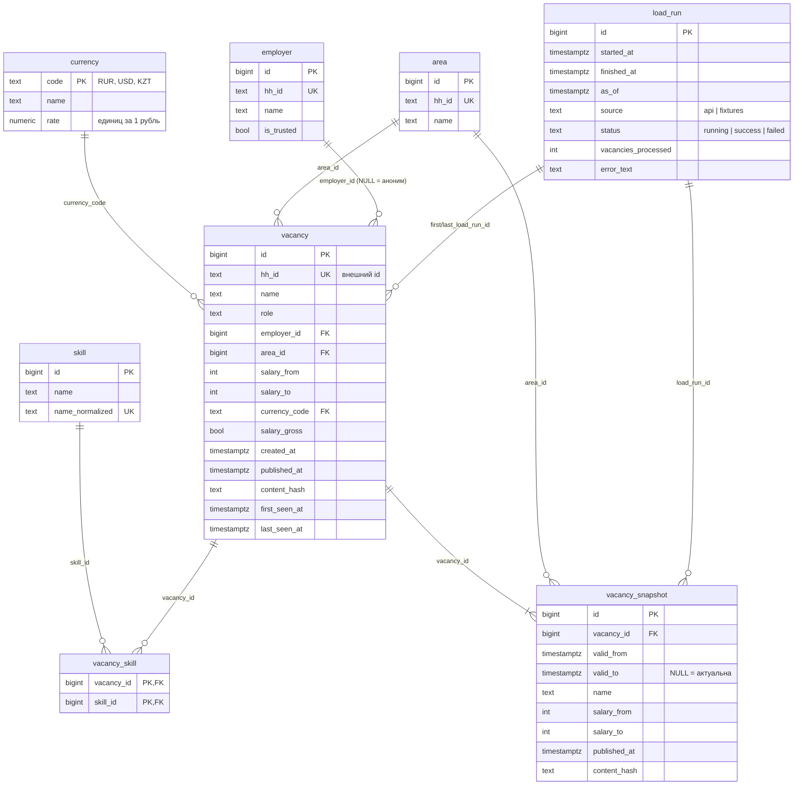

# Модель данных

DDL — в [`sql/001_schema.sql`](../sql/001_schema.sql). Интерактивная версия диаграммы, где клик по таблице объясняет её, — в разделе «Модель данных» сайта `explainer/index.html`.

> SVG через `mmdc` (mermaid-cli) не сгенерирован: утилиты нет на машине, а её установка тянет за собой отдельный Chromium. GitHub и большинство редакторов Markdown рисуют блок ниже сами.

## Как читать диаграмму

- `||--o{` — «один ко многим, может быть ноль»: у работодателя 0…N вакансий.
- `||--|{` — «один ко многим, минимум одна»: у вакансии всегда есть хотя бы одна версия в истории (загрузчик пишет её сразу).
- `PK` — первичный ключ, `FK` — внешний ключ, `UK` — уникальный ключ.

## Таблицы: зачем каждая

| Таблица | Что хранит | Зачем нужна | Вопрос |
|---------|------------|-------------|--------|
| `vacancy` | Текущее состояние вакансии, одна строка на `hh_id` | Быстрые ответы «как сейчас» без поиска последней версии | 1, 4, 5 |
| `vacancy_snapshot` | Все версии вакансии с периодом действия | История: как часто меняют, какая была первая зарплата | 2, 3 |
| `employer` | Работодатели | Не повторять название в каждой вакансии; считать по компании | 3, 6 |
| `area` | Города | Разрезы по городам | 2, 4 |
| `currency` | Курсы валют | Привести зарплаты к рублям | 2 |
| `skill` | Справочник навыков | Один навык = одна строка, без «SQL» и «sql» отдельно | 1 |
| `vacancy_skill` | Какие навыки у какой вакансии | Связь многие-ко-многим | 1 |
| `load_run` | Журнал запусков | Аудит: когда грузили, сколько, с какими ошибками | US-8 |

## Ограничения (constraints): какие и зачем

**Ограничение** — правило, которое база проверяет при каждой записи. Если правило нарушено, запись отклоняется. Это последняя линия защиты: даже если в Python-коде ошибка, мусор в базу не попадёт.

| Ограничение | Что запрещает | Почему важно |
|-------------|---------------|--------------|
| `vacancy.hh_id UNIQUE` | Две строки на одну вакансию hh.ru | На нём держится `ON CONFLICT` и идемпотентность |
| `chk_vacancy_salary_range` | `salary_from > salary_to` | Иначе середина вилки будет бессмысленной |
| `chk_vacancy_currency` | Зарплата без валюты или валюта без зарплаты | 100 000 чего? Без валюты число нельзя сравнить |
| `salary_from > 0` | Нулевая и отрицательная зарплата | Ноль — это «не указано», а не «0 рублей» |
| `role CHECK IN (...)` | Опечатки в роли ('sytem_analyst') | Опечатка тихо выкинула бы вакансии из отчёта |
| `uq_snapshot_current` (частичный индекс) | Две «актуальные» версии одной вакансии | Иначе запрос «текущая версия» вернёт две строки |
| `chk_snapshot_period` | `valid_to <= valid_from` | Версия не может закончиться раньше, чем началась |
| `chk_load_run_error` | Статус `failed` без текста ошибки | Упавший запуск должен объяснить, почему упал |
| `vacancy_skill PRIMARY KEY (vacancy_id, skill_id)` | Один навык дважды у одной вакансии | Иначе навык посчитается дважды в топе |

## Почему нормализация

**Нормализация** — раскладка данных по таблицам так, чтобы каждый факт хранился ровно в одном месте.

Представим, что навыки хранятся строкой: `vacancy.skills = 'SQL, BPMN, sql, Jira'`. Что пойдёт не так:

1. **Посчитать топ навыков трудно.** Нужно резать строку по запятым прямо в SQL, обрезать пробелы, приводить регистр. Каждый запрос повторяет эту логику — и где-то её забудут.
2. **Нет защиты от дублей.** «SQL» и «sql» в одной строке посчитаются дважды.
3. **Индекс не поможет.** Найти «все вакансии с Kafka» = `LIKE '%Kafka%'` по всей таблице. Такой поиск ещё и найдёт «Kafka Streams», когда нужен ровно Kafka.
4. **Переименование дорогое.** Решили, что «Postgres» = «PostgreSQL» — надо переписать тысячи строк. В нормализованной схеме — одна строка в `skill`.

С таблицами `skill` + `vacancy_skill` топ навыков — это `JOIN` и `GROUP BY`, а дубли запрещены первичным ключом.

**Цена нормализации:** больше таблиц и `JOIN`-ов, вставка вакансии — несколько запросов вместо одного. Для аналитической базы на тысячи строк это незаметно.

**Где мы сознательно НЕ нормализуем:** `vacancy_snapshot` повторяет поля `vacancy` (название, зарплату). Это осознанное дублирование: история должна хранить значения *на тот момент*, а не ссылку на текущие.
